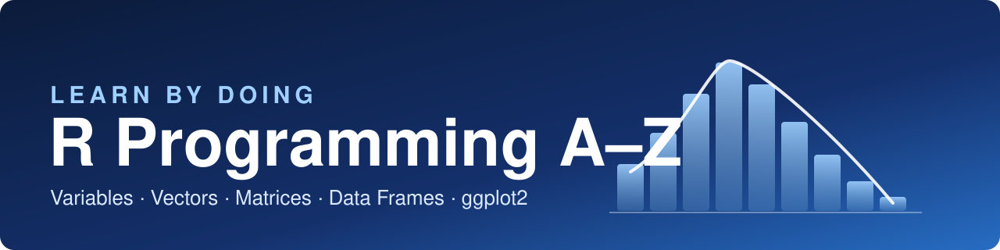

<p align="center">
  <a href="https://www.r-project.org/"></a>
  <a href="https://ggplot2.tidyverse.org/"></a>
  <a href="https://posit.co/products/open-source/rstudio/"></a>
  <a href=".github/workflows/r-check.yml"></a>
  
  
</p>

A hands-on R course in **45 commented lecture scripts**, from your first variable to a full **ggplot2** workflow on a real movie-ratings dataset. Each script is a self-contained lesson: explanation, runnable examples, and key takeaways in the comments.

> *"Learn the language by writing it: 45 scripts, 5,912 lines of annotated R, one dataset, zero shortcuts."*

---

## Course map

| # | Section | Scripts | What you work on |
|:-:|---------|:-------:|------------------|
| 00 | [Quickstart](00-quickstart/) 🎯 | 1 | Average revenue by country in a few lines |
| 01 | [Core Programming Principles](01-core-programming/) 🧩 | 11 | Types, logicals, `if/else`, `while` / `for`, simulation |
| 02 | [Fundamentals of R](02-fundamentals/) 🚀 | 5 | Vectors, `[]`, vectorization, custom functions |
| 03 | [Matrices & Advanced Operations](03-matrices/) 🧮 | 8 | Basketball statistics with matrices |
| 04 | [Data Frames & Analysis](04-data-frames/) 📊 | 10 | Import, filter, merge, EDA, `qplot()` |
| 05 | [Advanced Visualization with ggplot2](05-ggplot2/) 📈 | 10 | Layers, facets, themes on 562 movies |

---

## Learning path

```
 Quickstart ──► Core Programming ──► Fundamentals ──► Matrices ──► Data Frames ──► ggplot2
   (00)            variables            vectors         matrix         import          layers
                   logicals             [] subsets      algebra        filter          facets
                   if / else            vectorized      naming         merge           stats
                   while / for          functions       subsetting     EDA, qplot      themes
```

Each section builds on the previous one: vectors from Section 2 become the columns of the matrices in Section 3, matrices lead into data frames in Section 4, and data frames feed the ggplot2 charts in Section 5.

---

## Script tour

<details>
<summary>🧩 <b>Section 1 — Core Programming Principles</b> (11 scripts)</summary>

| Script | Topic |
|---|---|
| [`using-the-console.R`](01-core-programming/using-the-console.R) | Using the console in RStudio |
| [`my-first-script.R`](01-core-programming/my-first-script.R) | Data types in R |
| [`variables.R`](01-core-programming/variables.R) | Basic data types and variables |
| [`practice-with-variables.R`](01-core-programming/practice-with-variables.R) | Exercise: assigning variables |
| [`logical-values.R`](01-core-programming/logical-values.R) | Comparison and logical operators |
| [`conditional-if-else.R`](01-core-programming/conditional-if-else.R) | Conditional statements: `if`, `else if`, `else` |
| [`while-loop.R`](01-core-programming/while-loop.R) | Understanding the `while` loop |
| [`practice-while-and-for-loops.R`](01-core-programming/practice-while-and-for-loops.R) | Loops: `while` and `for` |
| [`law-of-large-numbers.R`](01-core-programming/law-of-large-numbers.R) | Law of large numbers, simulated |
| [`extra-rnorm.R`](01-core-programming/extra-rnorm.R) | Random numbers with `rnorm()` |
| [`workspace-management-rm.R`](01-core-programming/workspace-management-rm.R) | Workspace management with `rm()` |

</details>

<details>
<summary>🚀 <b>Section 2 — Fundamentals of R</b> (5 scripts)</summary>

| Script | Topic |
|---|---|
| [`vectors.R`](02-fundamentals/vectors.R) | Understanding vectors |
| [`square-brackets.R`](02-fundamentals/square-brackets.R) | Using `[]` brackets |
| [`advanced-square-brackets.R`](02-fundamentals/advanced-square-brackets.R) | Advanced `[]` usage |
| [`vectorized-operations.R`](02-fundamentals/vectorized-operations.R) | The power of vectorized operations |
| [`functions.R`](02-fundamentals/functions.R) | Functions in R |

</details>

<details>
<summary>🧮 <b>Section 3 — Matrices & Advanced Operations</b> (8 scripts)</summary>

| Script | Topic |
|---|---|
| [`working-with-matrices.R`](03-matrices/working-with-matrices.R) | Working with matrices |
| [`naming-dimensions.R`](03-matrices/naming-dimensions.R) | Naming dimensions in matrices and vectors |
| [`advanced-matrix-operations.R`](03-matrices/advanced-matrix-operations.R) | Advanced matrix operations |
| [`subsetting.R`](03-matrices/subsetting.R) | Subsetting |
| [`basketball-data.R`](03-matrices/basketball-data.R) | Course project: basketball data setup |
| [`basketball-matrix-operations.R`](03-matrices/basketball-matrix-operations.R) | Course project: matrix operations on basketball data |
| [`colnames-rownames-extra-viz.R`](03-matrices/colnames-rownames-extra-viz.R) | `colnames()` / `rownames()` plus an extra ggplot2 visualization |
| [`ggplot2-advanced-customizations.R`](03-matrices/ggplot2-advanced-customizations.R) | Advanced ggplot2 customizations |

</details>

<details>
<summary>📊 <b>Section 4 — Data Frames & Analysis</b> (10 scripts)</summary>

| Script | Topic |
|---|---|
| [`data-import-and-exploration.R`](04-data-frames/data-import-and-exploration.R) | Data import and exploration |
| [`exploratory-data-analysis.R`](04-data-frames/exploratory-data-analysis.R) | Exploratory data analysis (EDA) |
| [`building-data-frames.R`](04-data-frames/building-data-frames.R) | Building data frames |
| [`country-region-vectors.R`](04-data-frames/country-region-vectors.R) | Helper vectors (country, region) for the demographic exercises |
| [`dollar-sign-operator.R`](04-data-frames/dollar-sign-operator.R) | Using the `$` sign |
| [`filtering-data-frames.R`](04-data-frames/filtering-data-frames.R) | Filtering data frames |
| [`merging-data-frames.R`](04-data-frames/merging-data-frames.R) | Merging data frames |
| [`intro-to-qplot.R`](04-data-frames/intro-to-qplot.R) | Introduction to `qplot()` |
| [`qplot-visualization.R`](04-data-frames/qplot-visualization.R) | Visualization with `qplot()` |
| [`advanced-qplot-visualization.R`](04-data-frames/advanced-qplot-visualization.R) | Advanced visualization with `qplot()` |

</details>

<details>
<summary>📈 <b>Section 5 — Advanced Visualization with ggplot2</b> (10 scripts)</summary>

| Script | Topic |
|---|---|
| [`data-preparation-and-cleaning.R`](05-ggplot2/data-preparation-and-cleaning.R) | Data preparation and cleaning |
| [`plotting-with-layers.R`](05-ggplot2/plotting-with-layers.R) | Plotting with layers |
| [`layer-creation.R`](05-ggplot2/layer-creation.R) | Layer creation |
| [`mapping-vs-setting.R`](05-ggplot2/mapping-vs-setting.R) | Mapping vs setting aesthetics |
| [`overriding-aesthetics.R`](05-ggplot2/overriding-aesthetics.R) | Overriding aesthetics |
| [`statistical-transformations.R`](05-ggplot2/statistical-transformations.R) | Statistical transformations |
| [`facets.R`](05-ggplot2/facets.R) | Using facets |
| [`histograms-and-density.R`](05-ggplot2/histograms-and-density.R) | Histograms and density charts |
| [`coordinates.R`](05-ggplot2/coordinates.R) | Coordinates |
| [`themes.R`](05-ggplot2/themes.R) | Perfecting plots with themes |

</details>

---

## Featured: the ggplot2 workflow

Section 5 walks through the grammar of graphics on **562 films** (7 genres, 2007–2011) with critic ratings, audience ratings and budgets.

| Dimension | Detail |
|-----------|--------|
| **Dataset** | [`data/movie-ratings.csv`](data/movie-ratings.csv): Film · Genre · Rotten Tomatoes % · Audience % · Budget · Year |
| **Concepts** | Data → aesthetics → geometries → statistics → facets → coordinates → themes |
| **Reference** | [Grammar of Graphics (PDF)](docs/grammar-of-graphics.pdf) |

<details>
<summary>📈 Sample from <code>05-ggplot2/facets.R</code></summary>

```r
library(ggplot2)
movies <- read.csv("data/movie-ratings.csv")
colnames(movies) <- c("Film", "Genre", "CriticRating", "AudienceRating", "BudgetMillions", "Year")

v <- ggplot(data = movies, aes(x = BudgetMillions))

v + geom_histogram(binwidth = 10, aes(fill = Genre), colour = "black") +
  facet_wrap(~Genre) +
  ggtitle("Histogram Faceted by Genre") +
  theme_minimal()
```

</details>

---

## Repository layout

```
R-Programming-A-Z/
├── 00-quickstart/          # short warm-up script
├── 01-core-programming/    # one folder per course section,
├── 02-fundamentals/        #   each with its own README
├── 03-matrices/
├── 04-data-frames/
├── 05-ggplot2/
├── data/                   # datasets used by the scripts
├── docs/                   # reference material
├── assets/                 # README banner
├── .github/workflows/      # CI: syntax check for every R script
└── R-Programming-A-Z.Rproj
```

**Why a single `main`?** This repo used to keep every section on its own branch. Everything now lives on `main`, and the original branch history is preserved in the commit graph.

---

## Quick start

```bash
git clone https://github.com/evgeniimatveev/R-Programming-A-Z.git
cd R-Programming-A-Z
```

1. Open **`R-Programming-A-Z.Rproj`** in RStudio. It sets the working directory to the repo root, which the scripts rely on (e.g. `data/movie-ratings.csv`).
2. Install the packages once: `install.packages(c("ggplot2", "dplyr", "reshape2"))` (`dplyr` and `reshape2` are only needed by `03-matrices/ggplot2-advanced-customizations.R`).
3. Work through the sections in order, running each script top to bottom.

---

## Continuous integration

Every push and pull request runs [`r-check.yml`](.github/workflows/r-check.yml):

| Check | What it catches |
|-------|-----------------|
| **Parse every `.R` file** | Syntax errors |
| **Absolute path scan** | Hard-coded paths such as `C:/Users/...` |
| **File-name hygiene** | Spaces in file names |

Scripts are teaching material: CI verifies that they parse, it does not execute them end to end.

---

## Known limitations

- Section 4 scripts load their dataset with `file.choose()`. The course's demographic CSV is **not included** here.
- `qplot()` is deprecated in recent ggplot2 releases but kept because it is part of the course.
- `01-core-programming/while-loop.R` is **interactive**: it asks for input with `readline()`, so run it in the RStudio console (it hangs under `Rscript`).
- `03-matrices/ggplot2-advanced-customizations.R` is **not standalone**: it uses the `FieldGoals` matrix created in `basketball-data.R`, so run that script first in the same session.

---

## Credits

This repository holds my annotated study scripts for the **R Programming A–Z** course by Kirill Eremenko ([Super Data Science](https://www.superdatascience.com)). The course's lecture structure, exercises and datasets are the basis for these scripts; a few files (for example `04-data-frames/country-region-vectors.R` and `03-matrices/basketball-data.R`) contain material provided by the course. All rights to the original course content remain with its author.

---

## Tech stack

`R` · `RStudio` · `ggplot2` · `dplyr` · `reshape2` · `GitHub Actions`

---

*Built by [Evgenii Matveev](https://github.com/evgeniimatveev) · Data Analyst / Analytics & MLOps Engineer*
